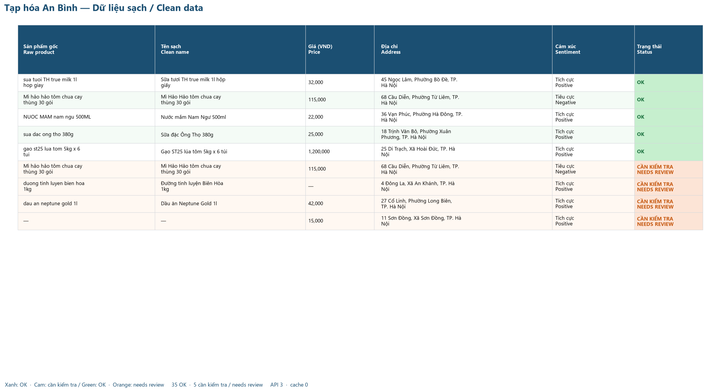

# AI Data Enrichment

Turn a messy Vietnamese mini-mart spreadsheet into a clean, bilingual Excel report. Prices and phone numbers are normalized with rules. Product names, post-July 2025 Hanoi addresses, and review sentiment go to Gemini in batches, then come back as validated JSON.



*Tạp hóa An Bình — Dữ liệu sạch / Clean data. Green is OK, orange needs a person.*

## Before → after

The sample is a fictional Hanoi shop, Tạp hóa An Bình. These three rows are from `sample_output/enriched.xlsx`.

| Raw product | Raw price | Clean name | Price (VND) | Address | Status |
| --- | --- | --- | --- | --- | --- |
| sua tuoi TH true milk 1l hop giay | 32.000đ | Sữa tươi TH true milk 1l hộp giấy | 32,000 | 45 Ngọc Lâm, Phường Bồ Đề, TP. Hà Nội | OK |
| gao st25 lua tom 5kg x 6 tui | 1tr2 | Gạo ST25 lúa tôm 5kg x 6 túi | 1,200,000 | 25 Di Trạch, Xã Hoài Đức, TP. Hà Nội | OK |
| dau an neptune gold 1l | 42.000đ | Dầu ăn Neptune Gold 1l | 42,000 | 27 Cổ Linh, Phường Long Biên, TP. Hà Nội | CẦN KIỂM TRA / NEEDS REVIEW |

The milk row shows the address change: the old text said Phường Ngọc Lâm, Quận Long Biên. Since 1 July 2025 Hanoi has no district level, and old Phường Ngọc Lâm sits in Phường Bồ Đề. `1tr2` is 1,200,000 VND. The oil row is flagged because `0123 456 789` is not a current mobile number; the product and the street were still cleaned.

Five of the 40 sample rows land on the review sheet: a duplicate, an unparseable price (`lien he`), that invalid phone, an empty product, and `gan cho, hn`, which is too vague to assign a ward.

## Features

- Rule pass first: VND prices (`25.000đ`, `25k`, `25,000`, `1tr2`), mobile numbers (`0912 345 678`, `+84912345678`, `912.345.678`), whitespace, and exact-row duplicates. Only product, address, and feedback text go to the model.
- Gemini batches (default 15 rows) with a fixed system prompt and a JSON schema checked by Pydantic. Customer names and phone numbers are not sent.
- A short suburban-Hanoi gazetteer (Resolution 1656/NQ-UBTVQH15) rewrites streets the model is shaky on, including Kiêu Kỵ, Đông La → Xã An Khánh, and Tây Mỗ. Unknown streets stay `needs review` instead of an invented ward.
- Disk cache under `cache/`, keyed by model + system prompt + batch. A repeat run does not call the API.
- Retry with exponential backoff on HTTP 429 and 5xx, a pause between calls for free-tier rate limits, and a progress bar.
- If `gemini-2.5-flash-lite` returns 404, the CLI follows the replacement model named in Google's error.
- `--offline` / `--dry-run` replays `sample_output/mock_responses.json`. No API key required.
- Workbook with frozen header, filters, VND number format, green/orange status, a category bar chart, and a review sheet. Sheet titles use `·` because Excel rejects `/` in a sheet name; headers and status text keep the `Tiếng Việt / English` form.

## Tech stack

Python 3.15, `google-genai`, Pydantic, pandas, openpyxl, python-dotenv, tqdm, matplotlib.

## Setup

```powershell
python -m venv .venv
.\.venv\Scripts\Activate.ps1
pip install -r requirements.txt
copy .env.example .env
```

Put a key from [Google AI Studio](https://aistudio.google.com/apikey) in `.env`:

```
GEMINI_API_KEY=your_key_here
```

The key is loaded with python-dotenv. It is never printed. `.gitignore` already ignores `.env`, `.venv/`, `output/`, and `cache/`.

This folder already has a `.venv`. Use that interpreter rather than creating another one:

```powershell
.\.venv\Scripts\python.exe -m pip install -r requirements.txt
```

Rebuild the fictional workbook any time:

```powershell
.\.venv\Scripts\python.exe make_samples.py
```

## Usage

```powershell
.\.venv\Scripts\python.exe main.py sample_input/shop_data.xlsx -o output/enriched.xlsx
.\.venv\Scripts\python.exe main.py sample_input/shop_data.xlsx -o output/enriched.xlsx --model gemini-3.5-flash-lite --batch-size 15
.\.venv\Scripts\python.exe main.py sample_input/shop_data.xlsx -o output/enriched_offline.xlsx --offline
```

| Flag | Meaning |
| --- | --- |
| `-o` | Output workbook. Default `output/enriched.xlsx`. |
| `--model` | Gemini model. Default `gemini-3.5-flash-lite`. |
| `--batch-size` | Rows per call. Default 15. |
| `--offline`, `--dry-run` | Bundled mock, no API key. |
| `--no-cache` | Ignore `cache/` for this run. |
| `--preview-image` | Also write a PNG of the clean-data sheet. |

Missing file, missing key, and API errors exit with a bilingual message. A missing key suggests `--offline`.

`output/enriched.xlsx` has three sheets:

- **Dữ liệu sạch · Clean data** — original columns beside the enriched ones.
- **Tổng hợp · Summary** — counts by category, sentiment, rows to review, API calls, cache hits, and tokens, plus one bar chart.
- **Cần kiểm tra · Review** — only the flagged rows and the reason.

## Offline mode

`--offline` joins each row to `sample_output/mock_responses.json` on product + address + feedback. The mock is generated with the sample by `make_samples.py`, so a clone can run the whole pipeline without a key. Rows the mock does not know are marked for review instead of failing the run.

## Cost and tokens

The live sample (40 rows, batch size 15, `gemini-3.5-flash-lite`) was **3 API calls**, **5,121 input tokens**, **8,427 output tokens**, **13,548 total**. A second run with the same model and prompt read `cache/` and reported 0 API calls and 3 cache hits.

`gemini-2.5-flash-lite` was the intended default. New API keys currently get HTTP 404 for it; Google's error points at `gemini-3.5-flash-lite`, which is what this repo calls unless you pass `--model`. Check the current free-tier limits in AI Studio before a large file. The client waits 4.5 seconds between calls and backs off on 429 and 5xx. Token totals count live calls only.

## Project structure

```
ai-data-enrichment/
├── main.py                 CLI
├── enrich.py               rules, Gemini batches, cache, workbook
├── make_samples.py         fictional shop workbook + offline mock
├── requirements.txt
├── .env.example
├── tests/test_normalize.py
├── sample_input/shop_data.xlsx
└── sample_output/
    ├── enriched.xlsx       live run, copied for the README
    ├── mock_responses.json
    └── screenshot.png
```

`output/` and `cache/` are local and gitignored.

## Sample data

Shop, customers, and phone numbers are fictional. Brands in the product text are real. Streets are real suburban Hanoi roads (Long Biên, Gia Lâm, Hoài Đức, Nam Từ Liêm, Hà Đông, Tây Mỗ) paired with the commune those streets belong to after the 2025 reorganization. The clean form is `<số> <đường>, Phường/Xã <tên>, TP. Hà Nội`.
